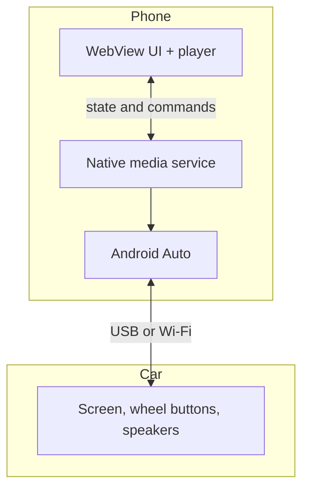
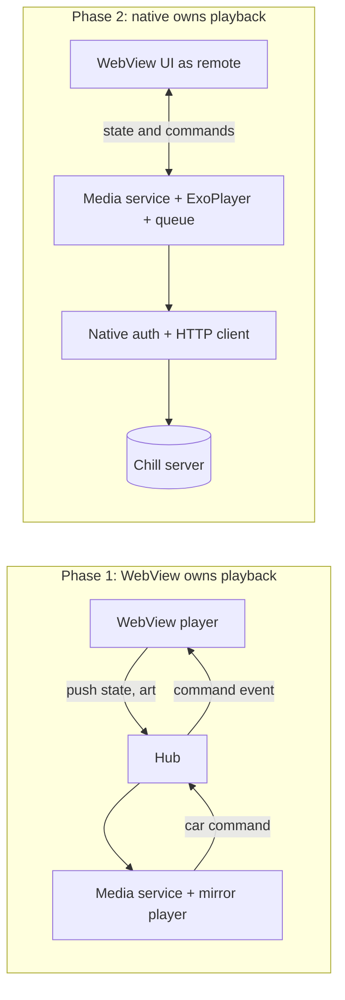
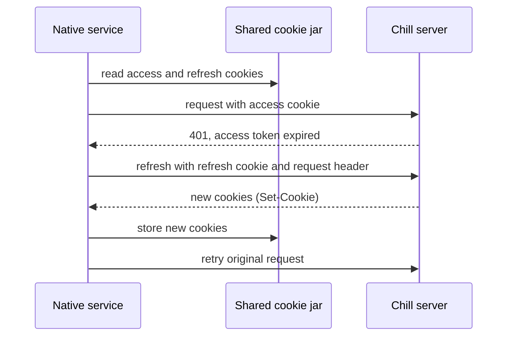

# Android Auto Support - Plan

## Goal Capsule

- **Objective:** Make Chill usable from Android Auto on the Pixel running the native app. Phase 1 is a car-side control for what the phone is playing. Phase 2 is browsing and playing from the car, with a native player that owns playback.
- **Product authority:** The Product Contract below. Where the Planning Contract and the Product Contract disagree on behavior, the Product Contract wins.
- **Execution profile:** Phase 1 (U1 to U6) is merged and was tried in the car. Phase 2 (U7 to U11) is planned in full and ships as two car-tested milestones: A (U7 to U9, native player and browse) and B (U10 to U11, phone UI as remote, mirror removed). Do not start B before A is verified in the car.
- **Stop conditions:** Stop and re-plan if the native service cannot read the WebView's cookies on a cold start (U7 spike), or if Opus-in-Ogg is not gapless on ExoPlayer on the device (U8). The phase 1 stop condition about the WebView in the background held in testing.
- **Open blockers:** None.

---

## Product Contract

### Summary

Chill appears in Android Auto in two phases. Phase 1 shows now-playing and play, pause and skip controls for whatever the phone is playing, with the phone's WebView player unchanged. Phase 2 adds browsing and starting playback from the car screen, with a native player owning playback on the phone and the phone UI acting as a remote for it, so phone and car always show the same queue and position.

### Problem Frame

Bluetooth audio caps quality in the car (ADR-0002), and a web UI cannot project into Android Auto (ADR-0005), so the car is the one place the existing app cannot reach. Playback today lives entirely in the phone WebView (`client/state/playerStore.ts`), and the Android side is an empty shell (`android/app/src/main/java/com/adalfonso/chill/MainActivity.java`) with no media service.

### Key Decisions

- **Two phases: control first, browse second.** (session-settled: user-directed — chosen over a single browse-and-play release and over control-only: the control layer is useful on its own and de-risks the larger native player work.)
- **Native player owns playback on the phone in the end state; phase 1 mirrors the WebView.** (session-settled: user-approved — chosen over a car-only second player and over a permanent mirror: one source of truth, and a mirror cannot play from a cold car.) Governs R4, R9, R10.
- **Phone and car show the same playback, in sync.** (session-settled: user-directed — chosen over "phone UI takes over" and over treating the car as a DeviceConnect device.) Governs R4, R9.
- **Cold start in phase 1 shows a message instead of starting playback.** (session-settled: user-approved — chosen over resuming the last queue: starting the WebView from the car is costly before a native player exists.) Governs R5.
- **Phase 1 car view mirrors only the phone's own player, not a device the phone is remote-controlling.** (session-settled: user-approved — chosen over mirroring the remote device's state.) Governs R6.
- **Phone-to-phone control survives phase 2; Chromecast stays in the WebView and pauses native playback while casting.** (session-settled: user-approved — chosen over rebuilding both natively at once.) Governs R12, R13.
- **Start sideloaded, design to be Play-compliant.** (session-settled: user-directed — chosen over Play-only and over sideload-only.) Governs R1.

### Actors

- A1. Driver: the user, controlling Chill from the car screen or steering wheel.
- A2. Chill phone app: the existing WebView UI and player on the phone.
- A3. Chill native media service: the new Android-side component Android Auto talks to.
- A4. Android Auto: built into Android on the phone; draws the car UI and relays input.
- A5. Other Chill devices (for example the iPad): web clients linked through DeviceConnect.

In phase 1 the WebView is the source of truth and the native service mirrors it. In phase 2 the native player is the source of truth and the WebView is a remote.

### Requirements

**Phase 1: car control of the existing player**

- R1. Chill appears as a media app in Android Auto on a sideloaded install.
- R2. The car shows now-playing: title, artist, album art, play state, and position.
- R3. Play, pause, next, previous, and seek from the car screen or steering wheel act on the phone's current playback.
- R4. The car view always matches the phone's player; the car holds no state of its own.
- R5. When nothing is playing or the app is not running, Chill in the car shows a message to start playback on the phone.
- R6. While the phone is remote-controlling another Chill device, the car shows the same message as R5.
- R7. Phase 1 does not change existing playback, DeviceConnect, or login behavior.

**Phase 2: browse and play from the car**

- R8. The car can browse the library and start playback of a track or album chosen there.
- R9. A native player owns playback on the phone; the phone UI shows and controls the same queue and position as the car.
- R10. Tapping Chill in the car with nothing playing resumes the last queue without the phone UI open.
- R11. The scrubber and elapsed clock, volume, playback-error recovery, and audio-quality selection behave as they do today.
- R12. Phone-to-phone control works with the phone as source and as target.
- R13. Chromecast keeps working from the phone UI; native playback pauses while a cast session is active.
- R14. Gapless playback between tracks is at least as good as today.

**Sign-in**

- R15. The car needs no separate login. A signed-out phone shows a "sign in on phone" message in the car, and signing out on the phone ends car access.

### Key Flows

- F1. Phase 1 playback
  - **Trigger:** The phone connects to the car while music plays.
  - **Actors:** A1, A2, A3, A4
  - **Steps:** Chill shows now-playing in the car; the driver pauses or skips from the car; the phone player does so and both views update.
  - **Covered by:** R2, R3, R4
- F2. Phase 2 cold start
  - **Trigger:** The phone connects to the car with Chill closed.
  - **Actors:** A1, A3, A4
  - **Steps:** The driver taps Chill; the last queue resumes, or the driver browses and picks something; the phone UI, opened later, shows the same queue and position.
  - **Covered by:** R8, R9, R10

### Acceptance Examples

- AE1. **Covers R5, R6.** Given the phone is controlling the iPad and nothing plays locally, when the driver opens Chill in the car, then the car shows the "start playback on the phone" message.
- AE2. **Covers R3, R4.** Given a track plays on the phone, when the driver pauses from the car, then the phone UI shows paused without any further action.
- AE3. **Covers R9, R10.** Given a track plays from the car after a cold start, when the driver opens the Chill UI on the phone, then it shows the same track at the same position.
- AE4. **Covers R13.** Given a Chromecast session is active, when the driver connects to the car, then native playback does not start over the cast.

### Scope Boundaries

**Deferred for later**

- Offline downloads (builds on the native player; see ADR-0005).
- Play Store release.
- Voice search and Assistant commands.
- Showing or controlling another device's playback from the car.
- Any web-player behavior not listed in R11 to R14.

### Dependencies and Assumptions

- Android Auto is built into Android 10 and newer. A sideloaded app appears only when "Unknown sources" is enabled in Android Auto's developer settings (applies to R1).
- Assumption, unverified: a native service in the app can reuse the signed-in session the WebView already holds. R15 depends on this; U7 verifies it before phase 2 builds on it.
- The user's car supports Android Auto; whether it is wired or wireless is not yet known and affects testing.
- Builds on persistent login sessions (ADR-0009) and the native login handoff already merged.

### Outstanding Questions

**Deferred to Implementation**

- Whether the car is wired or wireless Android Auto, for the test plan.

### Sources

- `client/state/playerStore.ts`: web player, queue, and the preload element used for gapless swaps.
- `client/components/App/PlayControls/Scrubber.tsx`: position tracking and the gapless trigger.
- `client/lib/registerClientSocket.ts`: DeviceConnect client wiring.
- `android/app/src/main/java/com/adalfonso/chill/MainActivity.java` and `AndroidManifest.xml`: current native shell.
- `docs/adr/0002-audio-codec-and-quality-tiers.md`, `docs/adr/0005-offline-sync-deferred-to-native-client.md`, `docs/adr/0009-persistent-login-sessions.md`.

---

## Planning Contract

Product Contract preservation: unchanged, except Outstanding Questions, where the questions planning resolved moved into the Key Technical Decisions below.

### Key Technical Decisions

- KTD1. **Add an in-app Capacitor plugin for WebView-to-native messaging, backed by a process-wide hub.** The Android service can start with no Activity, and a Capacitor plugin only exists while the bridge is alive. The hub holds the latest pushed state and the command listener, and the plugin attaches to it when it loads. Governs R2, R3, R4.
- KTD2. **One media library service for both phases; only its player changes.** Android Auto discovers a media3 `MediaLibraryService` through the manifest. Phase 1 backs the session with a mirror player that reports the pushed state. Phase 2 swaps in ExoPlayer behind the same session, so the manifest and car-facing surface stay stable. Governs R1, R8, R9.
- KTD3. **In phase 1 the WebView is the only source of truth, and the mirror never changes state on its own.** Car commands go to the WebView, and the car view updates only from the next WebView push. (session-settled: user-approved — chosen over a permanent mirror: it cannot play from a cold car.) Governs R3, R4.
- KTD4. **Push on change and on a coarse timer, extrapolate position in between.** The WebView pushes on track change, play or pause, seek, buffering start and end, and remote-control change. It also pushes a position about every 15 seconds while playing, to bound drift when a stream stalls. It does not push every second. The native player computes position from the last push time while playing, and freezes it while buffering. Position and buffering come from the audio element's events, because the player store has no position signal. Governs R2.
- KTD5. **In phase 1 the WebView delivers album art as small thumbnails.** The cover endpoint requires the login cookie, and Android Auto fetches art URLs without it. The WebView already holds the cookie, so it fetches a 256px image and sends it in the push, cached per cover. This keeps phase 1 free of any native sign-in code. Governs R2.
- KTD6. **In phase 2 the native service refreshes its own login and writes the renewed cookies back to the shared cookie jar.** It reads the access cookie for the server URL and the refresh cookie for the refresh endpoint URL, because the refresh cookie is scoped to that path. It refreshes with the refresh cookie and the required request header. It stores each full `Set-Cookie` it gets back, with every attribute and the original path, so the WebView stays signed in. One native refresh runs at a time, and it reads the jar at refresh time and never caches a token. A concurrent WebView refresh is tolerated: the server returns the successor token when the presented token is the immediate predecessor and the replay is within 30 seconds, and it revokes the whole family for any older ancestor (ADR-0009 KTD3, `server/lib/auth/LoginSession.ts`). Asking the WebView to refresh is rejected because it cannot work on a cold start. Governs R10, R15.
- KTD7. **In phase 2 ExoPlayer streams the existing load endpoint with the cookie attached and the default container.** Android decodes Opus in Ogg natively, so the web player's CAF fallback for Safari does not apply. Range streaming (ADR-0004) already supports seeking. Governs R9, R11, R14.
- KTD8. **In phase 2 the native player owns the queue and stores the last queue on the phone.** The last queue is not stored anywhere today; player state only moves between live devices. Saving it on the phone is enough for R10 and avoids a server change. A server-side copy shared across devices is deferred. (session-settled: user-approved — chosen over a permanent mirror and over a car-only player: one source of truth.) Governs R9, R10.
- KTD9. **In phase 2 the browse tree starts small and uses the existing library endpoints.** The tree is shuffle all, playlists, albums, and artists, with no search. The native client calls the same tRPC routes the web UI uses. Governs R8.
- KTD10. **Inside the native shell, the player store delegates to the native player behind one seam; the web build and iPad keep the Audio-element player.** DeviceConnect target commands, the scrubber, volume, and error handling go through that seam. Chromecast stays in the WebView, and native playback pauses while a cast session is active. Governs R11, R12, R13.
- KTD11. **Native code stays Java and adds only media3 libraries.** The existing shell is Java, and media3 works from Java. This avoids adding a Kotlin build setup for one feature. Pin the media3 version at implementation to the current stable release and check it against Google's current Android Auto media guide, which I only read in part while planning.
- KTD12. **A single native-platform check gates every new client path.** On the web, the iPad, and the PWA the new modules do nothing. Governs R7.

**Phase 2 decisions** (re-planned after phase 1 was tried in the car; KTD6 to KTD10 above still apply, refined here)

- KTD13. **Phase 2 ships as two car-tested milestones.** A (U7 to U9): native auth, native player, browse and cold-start resume, with the phone UI still playing through the WebView. B (U10, U11): the phone UI becomes a remote and the mirror goes away. (session-settled: user-approved — chosen over one milestone and over browse-only first: each milestone is tested in the car before the riskier flip.) Governs R8 to R15.
- KTD14. **Native auth reads the WebView cookie jar through a small interface, with a spike first and a hard stop if it fails.** `CookieManager.getCookie(url)` returns name and value pairs only and only for cookies matching that URL's path, which is why the refresh cookie is read for the refresh URL (KTD6). Write-back uses `setCookie` with the full `Set-Cookie` string and a flush. The native HTTP stack never installs a default `CookieHandler`, so the jar has one writer. A refresh has three outcomes: refreshed, signed out (a definitive 401 only), and transient failure (network, 5xx), and only the second ends the session and deletes the saved queue. If the cookie spike fails, stop and re-plan; a separate native login session is not planned. (session-settled: user-directed — chosen over falling back to a native device session via the login handoff.) Governs R10, R15.
- KTD15. **ExoPlayer plays a queue of media items for gapless, with audio focus and the cookie handled natively.** Preparing the next item ahead replaces the web player's 200 ms crossover hack. A data-source wrapper adds the access cookie on every request. Quality tier stays the server's per-user decision, so the user's setting is unchanged. A 401 on a stream refreshes and re-prepares once per item, matching the web player's recover-once rule. Volume is the player's own volume, as the web `volume` signal is, not the system stream. Governs R11, R14.
- KTD16. **The saved queue is the server's track JSON, stored verbatim, in the no-backup directory.** The phone UI needs full tracks (bitrate, file type and the rest), so native keeps each track as received and reads only the few fields it needs. Native parses that JSON in one place and coerces `duration`, since some routes send a string. The snapshot holds the tracks, index, position, and the shuffle flag with its original order, under a schema version. It is written atomically, saved on change and about every 15 s while playing, and discarded when corrupt, of an unknown version, or after sign-out. Governs R9, R10.
- KTD17. **The browse tree is Shuffle all, Playlists, Albums, and Artists, built from existing GET routes.** Artists lead to albums, albums lead to tracks, and playing an album or a track queues the surrounding list. Pages map onto the server's `limit`, `page` and `offset` options. Cover art goes through a native bitmap loader that carries the cookie, because Android Auto fetches art URLs on its own and cannot send it (the nginx rule for cover files must be checked at implementation, and the loader makes the answer irrelevant). Governs R8.
- KTD18. **The seam is one backend object the player store routes its mutators through, active only in the native shell.** In the native shell, with no cast session and no outgoing DeviceConnect connection, each store mutator calls the native backend, and the store's signals are updated from native snapshots through the existing `replaceState`. Everywhere else the existing code runs unchanged. DeviceConnect target commands arrive through the same socket handlers and reach native through the same mutators, so target echoes stay as they are. The phone cannot be a target while the WebView is closed, as today. Native owns the queue because the car can start playback with no WebView, which a store-owned queue cannot support. Refines KTD10. Governs R9, R11, R12.
- KTD19. **During milestone A, an arbiter swaps the session between the phase 1 mirror and the ExoPlayer; the last to start wins.** The ExoPlayer and the WebView player must never play at once. Starting from the car pauses the WebView over the phase 1 command channel. Starting on the phone pauses the ExoPlayer and returns the session to the mirror. The arbiter is throwaway: U11 deletes it with the mirror. Accepted cost of testing the native player in the car before the flip. Governs R4, R9.
- KTD20. **Casting and remote control take the player away from native, and native keeps its queue.** While the phone is casting or remote-controlling another device, native stays paused, the car shows the message state (AE1, AE4), and the WebView store is the authority through its existing paths. When either ends, the store's queue and position go back to native, paused. If the WebView goes away mid-cast, native clears the cast flag, because cast control lives only in the WebView. Governs R6, R12, R13.
- KTD21. **Native shell only needs the notification permission asked once.** Android 13 and newer hide the media foreground notification without `POST_NOTIFICATIONS`, though audio still plays. Ask once at first launch of the native shell, and do not ask again if declined. Governs R9.

### High-Level Technical Design

Phase 1 and phase 2 differ only in who owns the player. The service and the car-facing surface stay the same.

The phase 2 sign-in refresh keeps the WebView and the native service on one cookie jar:

### Assumptions

- The cookie manager returns HttpOnly cookies, including the `__Secure-` prefixed ones, for the server URL and for the refresh endpoint URL. U7 verifies this first.
- The WebView keeps playing audio while the app is in the background with the screen off. U1 verifies this before anything else.
- The media session shown in the car is built from the pushed state only. Android Auto draws the layout; this plan does not control it.

### Risks and Dependencies

- **The WebView may pause in the background.** Audio can keep playing while JavaScript and bridge events are throttled. Then track advance and every car command fail. Mitigation: U1 checks audio, auto-advance, and a command round-trip first, and the fallback is a foreground service that keeps the WebView alive.
- **Refresh races log the user out.** Two refreshes with the same token can trigger reuse detection and revoke the login session. Mitigation: KTD6's single native refresh, the server grace window, and a test for concurrent refreshes in U7.
- **Position drift.** Extrapolated position can differ from the WebView's, and a stalled stream freezes audio while the clock runs. Mitigation: push on seek, play-state change, and buffering changes, plus the coarse timer (KTD4).
- **Duplicate media controls.** The media3 service can add its own media notification beside whatever the WebView already shows. Mitigation: U6 checks the lock screen and notification shade, and U1 keeps the mirror player from taking audio focus.
- **Other apps connecting to the media service.** Android Auto needs the service exported. Mitigation: U1 accepts only Android Auto, the system media controller, and Chill's own package, and U9 carries the same rule into browsing.
- **Android Auto changes.** Sideload visibility and media3 behavior change across Android and Android Auto releases. Mitigation: verify against Google's current guide and on the Desktop Head Unit before the car.
- **Dependency:** the sign-in and native handoff work already merged (ADR-0009).

**Phase 2 risks**

- **Cookie jar not readable cold.** `CookieManager` may need WebView initialization in a fresh process, or may not return HttpOnly cookies. Mitigation: the U7 spike on a killed app comes first, with a hard stop.
- **Native refresh revokes the login.** A native refresh from a stale token, older than the immediate predecessor, revokes the whole family. Mitigation: the jar is re-read at every refresh and never cached, one refresh runs at a time, and the 30 second grace window covers a concurrent WebView refresh.
- **Two players at once during milestone A.** Mitigation: the arbiter (KTD19), covered by unit tests and the car test of A.
- **Gapless on Opus in Ogg.** Mitigation: the U8 device check is the stop condition; the pre-roll fallback is in Open Questions.
- **A large queue over the bridge.** Thousands of tracks as JSON may be slow to send. Mitigation: the queue goes only on change and on request at page load, with status updates kept small; measure with a long shuffle-all queue and add a cap if needed.
- **Stale cast flag.** A cast session that outlives the WebView leaves native unable to know. Mitigation: native clears the flag when the WebView goes away (KTD20); a car start then plays locally, which the user can pause.
- **The phone is not a DeviceConnect target with the WebView closed.** The socket lives in the WebView, as today. Accepted; R12 only requires it while the UI is running.
- **Wasted work.** The mirror and arbiter are built in phase 1 and A, then deleted in U11. Accepted for the earlier car test.

### System-Wide Impact

- The player store is the shared seam. The web build, the iPad, and the PWA must behave exactly as today; the new modules sit behind the native-platform check (KTD12).
- DeviceConnect keeps its server protocol. Only the phone-as-target path changes in phase 2, when commands go to the native player.
- No server changes in phase 1 or in phase 2: every route and cookie behavior phase 2 needs already exists. Web changes in U10 reach the app only after a Docker redeploy, because the app loads its UI from the server.
- Wire contract: the TypeScript and Java payloads are still hand-synced, and U10 grows them. Keep both sides' tests tied to the same example payloads.

---

## Implementation Units

### Phase 1: car control of the existing player

### U1. Android Auto wiring and media service skeleton

- **Goal:** Chill appears in Android Auto, and the service starts without the WebView and shows the "start playback on the phone" message.
- **Requirements:** R1, R5, R7
- **Dependencies:** none
- **Files:**
  - Create: `android/app/src/main/res/xml/automotive_app_desc.xml`
  - Create: `android/app/src/main/java/com/adalfonso/chill/media/ChillMediaService.java`
  - Create: `android/app/src/main/java/com/adalfonso/chill/media/MirrorPlayer.java`
  - Modify: `android/app/src/main/AndroidManifest.xml`
  - Modify: `android/app/build.gradle`, `android/variables.gradle`
  - Test: `android/app/src/test/java/com/adalfonso/chill/media/MirrorPlayerTest.java`
- **Approach:**
  - Declare Android Auto media support in the manifest, pointing to the new automotive app description.
  - Declare the service with the media3 library-service intent filter, per KTD2.
  - Declare the foreground-service and media-playback permissions and the media-playback service type, and decide whether the mirror posts a notification. The app targets Android 16, where a missing declaration crashes the service or hides its notification.
  - Accept a connecting controller only when it is Android Auto, the system media controller, or Chill's own package.
  - Add the media3 session dependency and pin its version in `variables.gradle`, per KTD11.
  - Build the session on `MirrorPlayer`, which extends media3's base player and holds one immutable state snapshot.
  - `MirrorPlayer` plays no audio and never requests audio focus, so it cannot interrupt the WebView's playback.
  - With no state pushed, report the message item from R5.
- **Execution note:** Before writing code, check on the Pixel, with the app backgrounded and the screen off, that the WebView keeps playing, that the next track starts on its own, and that an event sent from native reaches a WebView handler. If any of the three fails, take the foreground-service fallback or re-plan phase 1 (see Risks).
- **Patterns to follow:** The existing manifest structure and the `variables.gradle` version entries.
- **Test scenarios:**
  - With no pushed state, `MirrorPlayer` reports no media and the message item.
  - Happy path: after one pushed state, it reports that track, title, and play state.
  - Edge case: two states pushed in quick succession leave only the later one.
  - Edge case: a state with play state paused reports paused and a non-advancing position.
  - Edge case: a state with a duration reports it on the timeline, and a state with no next track reports next as unavailable.
  - Error path: a controller connecting from a package outside the allowlist is rejected.
- **Verification:** `./gradlew testDebugUnitTest` passes in `android/`. The debug APK installs. With Unknown sources on and the Desktop Head Unit connected, Chill appears and shows the message.

### U2. WebView-to-native messaging channel

- **Goal:** The WebView and the native service can exchange state and commands.
- **Requirements:** R2, R3, R4, R7
- **Dependencies:** U1
- **Files:**
  - Create: `android/app/src/main/java/com/adalfonso/chill/media/MediaBridgeHub.java`
  - Create: `android/app/src/main/java/com/adalfonso/chill/media/MediaBridgePlugin.java`
  - Modify: `android/app/src/main/java/com/adalfonso/chill/MainActivity.java`
  - Create: `client/lib/native/mediaBridge.ts`
  - Create: `common/nativeMedia.ts`
  - Test: `tests/mediaBridge.test.ts`
- **Approach:**
  - `common/nativeMedia.ts` holds the push and command payload types. It has no Prisma imports, per the project rule for shared types.
  - The plugin has one publish method and one command event. It attaches to the hub on load, per KTD1.
  - `MainActivity` registers the plugin before the base `onCreate`, as Capacitor requires for custom plugins.
  - `mediaBridge.ts` wraps the plugin behind the native-platform check from KTD12 and does nothing elsewhere.
  - Clear the hub's state and command listener when the plugin or the activity is destroyed. Also accept an explicit clear message from the client.
- **Patterns to follow:** Capacitor's custom-plugin registration. Verify the exact call against the installed Capacitor version.
- **Test scenarios:**
  - Happy path: on the native platform, publishing calls the plugin once with the payload.
  - Edge case: on the web, publishing is a no-op and does not throw.
  - Happy path: a command event reaches every subscribed handler.
  - Edge case: after unsubscribing, a handler receives no further commands.
  - Edge case: after teardown, the hub holds no state and no listener, and a later command is dropped.
- **Verification:** `pnpm test` passes. A debug build shows the plugin loading in the Chrome WebView inspector.

### U3. Push player state and album art to native

- **Goal:** The service always has the phone player's current track, play state, position, and art.
- **Requirements:** R2, R4, R7
- **Dependencies:** U2
- **Files:**
  - Create: `client/lib/native/syncPlayerToNative.ts`
  - Modify: `client/App.tsx`
  - Modify: `android/app/src/main/java/com/adalfonso/chill/media/MirrorPlayer.java`
  - Test: `tests/syncPlayerToNative.test.ts`
- **Approach:**
  - One module publishes on changes to the player store signals (`now_playing`, `is_playing`) and on the audio element's `seeked`, `playing`, `pause`, and `waiting` events, per KTD4. It also pushes a position on a coarse timer while playing. Mount it once from `client/App.tsx`.
  - Fetch the 256px cover for the current track through the existing cover endpoint and send it as a thumbnail, cached per cover filename, per KTD5. A failed fetch sends no art.
  - Include duration, whether a next and a previous track exist, a buffering flag, and whether the phone is remote-controlling another device. Take the remote flag from the outgoing-connection signal in `client/lib/registerClientSocket.ts`, because a virtual remote play also sets the local player signals.
  - `MirrorPlayer` computes position between pushes from the last push time while playing.
- **Patterns to follow:** The effect-based wiring in `client/lib/registerClientSocket.ts`.
- **Test scenarios:**
  - Happy path: a track change publishes new metadata once.
  - Happy path: pause then play publishes two play-state changes.
  - Edge case: a `seeked` event publishes immediately with the new position.
  - Edge case: no publish happens on position ticks between coarse timer pushes.
  - Happy path: a `waiting` event publishes buffering, and the next `playing` event clears it.
  - Edge case: a virtual remote play on the source publishes remote as true.
  - Happy path: the payload carries duration and reports next and previous as unavailable at the ends of the queue.
  - Error path: a failing cover fetch publishes state with no art and does not throw.
  - Edge case: the same cover requested twice is fetched once.
  - Integration: on the web, mounting the sync does nothing.
- **Verification:** `pnpm test` passes. On the Desktop Head Unit, playing a track on the phone shows its title and art.

### U4. Relay car commands to the WebView player

- **Goal:** Play, pause, next, previous, and seek in the car act on the phone's player.
- **Requirements:** R3, R4
- **Dependencies:** U2, U3
- **Files:**
  - Create: `client/lib/native/handleNativeCommands.ts`
  - Modify: `android/app/src/main/java/com/adalfonso/chill/media/MirrorPlayer.java`
  - Modify: `client/App.tsx`
  - Test: `tests/handleNativeCommands.test.ts`
- **Approach:**
  - `MirrorPlayer` forwards each car command to the hub, which emits the command event. It does not change its own state, per KTD3.
  - The client handler maps each command to the existing player store functions. Seek converts seconds to the percent the store expects, using the track duration.
  - After the player acts, the normal push from U3 updates the car.
- **Patterns to follow:** The existing store functions for play, pause, next, previous, and seek.
- **Test scenarios:**
  - Covers AE2. Pause from the car calls the store pause once, and the following push reports paused.
  - Happy path: next and previous call the matching store functions.
  - Edge case: a seek of 30 seconds on a 120 second track calls seek with 25 percent.
  - Edge case: an unknown action is ignored.
  - Error path: a command with no current track does nothing and does not throw.
- **Verification:** `pnpm test` passes. On the Desktop Head Unit, pause and skip from the car screen change the phone's player and the car view.

### U5. Message states for cold start, remote control, and sign-out

- **Goal:** The car shows the right message when there is nothing local to control.
- **Requirements:** R5, R6, and the sign-out half of R15 (signing out ends car access)
- **Dependencies:** U1, U3
- **Files:**
  - Modify: `android/app/src/main/java/com/adalfonso/chill/media/ChillMediaService.java`
  - Modify: `android/app/src/main/java/com/adalfonso/chill/media/MirrorPlayer.java`
  - Modify: `client/lib/native/syncPlayerToNative.ts`
  - Test: `android/app/src/test/java/com/adalfonso/chill/media/MirrorPlayerTest.java`
  - Test: `tests/syncPlayerToNative.test.ts`
- **Approach:**
  - Show the message when no state has been pushed (app closed or WebView on the login page) or when the pushed state says the phone is remote-controlling another device.
  - The login page is static HTML and does not run the player, so phase 1 cannot tell "closed" from "signed out". Use one message that covers both: open Chill on the phone, and sign in if needed. The separate "sign in on phone" state arrives in phase 2 with native sign-in (U7).
  - Clear the pushed state when the user signs out and when the WebView navigates to the login page, so the car stops showing the last track. Check Capacitor's page-load hook for the second case at implementation.
  - After a clear or a teardown, show the message and stop advancing position.
- **Test scenarios:**
  - Covers AE1. With remote control on and no local playback, the player reports the message.
  - Happy path: with local playback, the message does not show.
  - Edge case: when remote control ends and local playback resumes, the message clears on the next push.
  - Edge case: with no pushed state at all, the message shows.
  - Happy path: a clear message drops the track, art, and position, and the message shows.
  - Edge case: after the bridge is torn down, the player reports the message and stops extrapolating position.
- **Verification:** `./gradlew testDebugUnitTest` and `pnpm test` pass. On the Desktop Head Unit, closing the app shows the message, and starting playback replaces it.

### U6. Phase 1 verification and notes

- **Goal:** Phase 1 is proven in the real car, and the steps to repeat it are written down.
- **Requirements:** R1 to R7
- **Dependencies:** U1 to U5
- **Files:**
  - Create: `docs/android-auto.md`
- **Approach:**
  - Document enabling Unknown sources in Android Auto's developer settings, running the Desktop Head Unit, and a manual checklist covering each phase 1 requirement.
  - Check the lock screen and notification shade for a duplicate media notification beside the WebView's controls.
  - Run the checklist on the Desktop Head Unit, then in the car, wired or wireless.
- **Test expectation:** none. This unit is a manual verification and a document.
- **Verification:** The checklist passes in the car. Before phase 2 is planned in detail, the notes say whether background audio, art, and seek behaved as assumed.

### Phase 2: browse and play from the car

Phase 2 ships as two car-tested milestones (KTD13). Milestone A (U7 to U9) adds the native player, browsing and cold-start resume while the phone UI still plays through the WebView. Milestone B (U10, U11) turns the phone UI into a remote and removes the phase 1 mirror.

### U7. Native authenticated client

- **Goal:** The native service can call the server and stream audio as the signed-in user, without the WebView running, and stays signed in.
- **Requirements:** R10, R15
- **Dependencies:** U6
- **Files:**
  - Create: `android/app/src/main/java/com/adalfonso/chill/media/auth/CookieJar.java` (interface over the WebView cookie store, so tests can fake it)
  - Create: `android/app/src/main/java/com/adalfonso/chill/media/auth/WebViewCookieJar.java`
  - Create: `android/app/src/main/java/com/adalfonso/chill/media/auth/SessionAuth.java`
  - Create: `android/app/src/main/java/com/adalfonso/chill/media/auth/AuthedHttp.java`
  - Create: `android/app/src/main/java/com/adalfonso/chill/media/auth/ServerConfig.java`
  - Test: `android/app/src/test/java/com/adalfonso/chill/media/auth/SessionAuthTest.java`
  - Test: `android/app/src/androidTest/java/com/adalfonso/chill/media/auth/WebViewCookieJarTest.java`
- **Approach:**
  - Spike first, on the device with the app process killed: `CookieManager` must return the HttpOnly `__Secure-` access cookie for the server URL and the refresh cookie for `<server>/auth/refresh`. If either is missing, stop and re-plan (KTD14).
  - `ServerConfig` reads the server URL from the bundled Capacitor config, the same value the WebView loads.
  - `WebViewCookieJar` reads cookies per URL and writes back each full `Set-Cookie` string (path, `Secure`, `HttpOnly`, `SameSite`, expiry), then flushes. It does not install a default `CookieHandler`, so nothing else touches the jar.
  - `SessionAuth.refresh()` is single-flight, reads the jar at refresh time, and posts to the refresh endpoint with the `X-Requested-With` header and the refresh cookie. It returns one of three outcomes: refreshed, signed out (a definitive 401), or transient failure (network or 5xx). Only signed out changes state (KTD6, KTD14).
  - `AuthedHttp` attaches the access cookie, and on a 401 refreshes once and retries once.
  - Signed out notifies listeners. U8 deletes the saved queue on it, and the car shows a separate "sign in on phone" message (R15).
  - Coerce `duration` at the one place server track JSON is parsed natively (KTD16), since some routes send it as a string.
- **Execution note:** Start with the on-device cookie spike; everything else in this unit assumes its result.
- **Patterns to follow:** `client/lib/auth/refresh.ts` for single-flight, timeout and retry-on-401 semantics; `server/lib/auth/cookies.ts` for the cookie attributes to preserve.
- **Test scenarios:**
  - Happy path: a 401 triggers exactly one refresh, writes the new cookies, and retries the request once.
  - Error path: a refresh that returns 401 reports signed out, notifies listeners once, and does not loop.
  - Error path: a network failure or 5xx on refresh reports transient failure, leaves state signed in, and notifies nobody.
  - Integration: two simultaneous 401s produce one refresh request, and both callers retry with the new cookie.
  - Edge case: a second 401 after the retry is returned to the caller and does not refresh again.
  - Integration (device): after a write-back, the stored refresh cookie still has the `/auth/refresh` path, `Secure`, `HttpOnly` and `SameSite=Strict`, and the WebView's next request sends the renewed access cookie.
  - Edge case: the jar is re-read for every refresh, so a refresh done by the WebView in between is picked up and the stale token is never replayed.
  - Edge case: with no cookies in the jar, the result is signed out without a network call.
- **Verification:** `./gradlew testDebugUnitTest` passes, the device test passes, and on the phone a native refresh leaves the WebView signed in.

### U8. Native player, queue, and last-queue resume

- **Goal:** An ExoPlayer in the service streams from the server, owns the queue, and resumes the last queue from a cold tap with the phone UI closed.
- **Requirements:** R9, R10, R14, R11 (volume, error recovery, quality unchanged)
- **Dependencies:** U7
- **Files:**
  - Create: `android/app/src/main/java/com/adalfonso/chill/media/playback/NativePlayerFactory.java`
  - Create: `android/app/src/main/java/com/adalfonso/chill/media/playback/QueueStore.java`
  - Create: `android/app/src/main/java/com/adalfonso/chill/media/playback/QueueSnapshot.java`
  - Create: `android/app/src/main/java/com/adalfonso/chill/media/playback/TrackJson.java`
  - Create: `android/app/src/main/java/com/adalfonso/chill/media/playback/PlaybackArbiter.java`
  - Modify: `android/app/src/main/java/com/adalfonso/chill/media/ChillMediaService.java`
  - Modify: `android/app/src/main/java/com/adalfonso/chill/MainActivity.java` (ask for the notification permission once)
  - Modify: `android/app/build.gradle`, `android/variables.gradle` (media3 exoplayer and datasource, same pinned version)
  - Test: `android/app/src/test/java/com/adalfonso/chill/media/playback/QueueStoreTest.java`
  - Test: `android/app/src/test/java/com/adalfonso/chill/media/playback/TrackJsonTest.java`
  - Test: `android/app/src/test/java/com/adalfonso/chill/media/playback/PlaybackArbiterTest.java`
  - Test: `android/app/src/androidTest/java/com/adalfonso/chill/media/playback/NativePlayerTest.java`
- **Approach:**
  - `NativePlayerFactory` builds the ExoPlayer: music audio attributes with audio focus handled, pause on becoming noisy, a network wake mode, and a data source that adds the access cookie per request through a resolving wrapper over `AuthedHttp` (KTD7, KTD15).
  - The queue is a list of media items, so the next track is prepared ahead and gapless comes from ExoPlayer (KTD15). The track's server JSON rides along on each item untouched.
  - A stream that fails with 401 refreshes through `SessionAuth` and re-prepares at the same position, once per item, matching the web player's recover-once rule. Any other error leaves playback stopped, as today.
  - `QueueStore` persists the queue snapshot (tracks as server JSON, current index, position, shuffle flag and original order, schema version) to a file in the no-backup directory with an atomic write: temp file, then rename. It saves on queue and track change, on pause, and about every 15 s while playing (KTD16). A corrupt or unknown-version file is discarded.
  - A cold tap on Chill with no queue loaded reads the store, loads it paused at the saved position, and starts it. No store, signed out, or a cast flag set means the message state, not playback.
  - `PlaybackArbiter` implements milestone A's coexistence rule (KTD19): the session's player is the mirror while the WebView plays, and the ExoPlayer when the car started playback. Whichever starts second pauses the first. A native start sends the WebView a pause command over the phase 1 channel.
  - Request `POST_NOTIFICATIONS` once at first launch of the native shell. Without it, playback works but the foreground notification is hidden.
- **Execution note:** Verify gapless on a real device with two adjacent tracks of one album before building the rest on it; if Opus-in-Ogg shows a gap, fall back to the pre-roll approach noted in Open Questions.
- **Patterns to follow:** `MirrorPlayer.java` for how the session surface is described; `RenditionCache` behavior for what the load endpoint serves.
- **Test scenarios:**
  - Covers AE3. Save a queue at track 3, position 41 s, shuffled; load it in a fresh store and get the same tracks, index, position and shuffle order.
  - Edge case: a truncated or non-JSON file is discarded and loading reports no queue.
  - Edge case: a snapshot with an unknown schema version is discarded.
  - Edge case: a write interrupted before the rename leaves the previous snapshot intact.
  - Edge case: a track whose `duration` is the string "215.4" parses to 215.4 seconds, and an unparsable one becomes unknown.
  - Error path: signed out deletes the stored queue, and a later cold tap shows the sign-in message.
  - Happy path: the arbiter hands the session to the ExoPlayer when the car starts playback and sends the WebView a pause.
  - Happy path: when the WebView starts playing, the arbiter pauses the ExoPlayer and hands the session back to the mirror.
  - Error path (device): a 401 on the stream triggers one refresh and a re-prepare at the same position, and a second 401 on the same item stops playback.
  - Integration (device): gapless advance between two tracks of one album shows no audible gap, and the notification and lock-screen controls appear exactly once.
- **Verification:** unit tests and the device test pass. From a killed app, tapping Chill in the Desktop Head Unit resumes the saved queue. Quality tier and range seeking behave as the web player does.

### U9. Browse tree

- **Goal:** The car can browse the library and start playback of a track or album.
- **Requirements:** R8
- **Dependencies:** U7, U8
- **Files:**
  - Create: `android/app/src/main/java/com/adalfonso/chill/media/library/LibraryClient.java`
  - Create: `android/app/src/main/java/com/adalfonso/chill/media/library/LibraryTree.java`
  - Create: `android/app/src/main/java/com/adalfonso/chill/media/library/AuthedBitmapLoader.java`
  - Modify: `android/app/src/main/java/com/adalfonso/chill/media/ChillMediaService.java`
  - Test: `android/app/src/test/java/com/adalfonso/chill/media/library/LibraryTreeTest.java`
  - Test: `android/app/src/test/java/com/adalfonso/chill/media/library/LibraryClientTest.java`
- **Approach:**
  - The tree is from KTD17: Shuffle all, Playlists, Albums, Artists. Albums and artists list tracks or albums beneath, and tapping a track plays from it within its parent list.
  - `LibraryClient` calls the existing tRPC GET routes over plain HTTP through `AuthedHttp`, mapping the media3 page and size onto the server's `limit`, `page` and `offset` options.
  - Browsing a list returns at most one page; keep pages within Android Auto's list limits (assumed about 100, check against Google's guide at implementation).
  - `AuthedBitmapLoader` fetches cover art with the cookie, because Android Auto's own fetch carries none. Browse items carry art through it.
  - Playing a browse item resolves to its track list and loads it into the ExoPlayer starting at the chosen track. Shuffle all uses the random-tracks route, whose duration may be a string.
  - The `CallerAllowlist` check from U1 stays the single gate for browse and playback requests.
  - A failed library call returns an error item or error result and never throws out of the service. Signed out returns only the sign-in message.
- **Patterns to follow:** The existing `LibraryCallback` in `ChillMediaService.java`; the pagination shape in `common/schema.ts`.
- **Test scenarios:**
  - Happy path: the root lists Shuffle all, Playlists, Albums and Artists in that order.
  - Happy path: the Albums level maps page 2 of size 50 to the server's page and offset options.
  - Happy path: choosing an album queues its tracks in order and starts at the first.
  - Happy path: choosing the third track of an album starts at it with the rest queued.
  - Edge case: an empty playlist shows an empty-list result, not an error.
  - Error path: a failed library call returns an error result and the service keeps running.
  - Error path: signed out returns only the sign-in message, and no library call is made.
  - Error path: a controller outside the allowlist is rejected from browse as well as playback.
- **Verification:** unit tests pass. On the Desktop Head Unit, browse to an album and play it, then shuffle all. Milestone A is then car-tested before milestone B starts.

### U10. Flip the bridge: phone UI as a remote

- **Goal:** In the native shell the phone UI shows and controls the native queue and position, and DeviceConnect, Chromecast, scrubber and volume keep working.
- **Requirements:** R9, R11, R12, R13
- **Dependencies:** U8, U9
- **Files:**
  - Create: `client/lib/native/nativePlayerBackend.ts` (the seam, KTD18)
  - Create: `client/lib/native/nativePosition.ts` (position extrapolation shared by the Scrubber and the sync)
  - Modify: `client/state/playerStore.ts`
  - Modify: `client/components/App/PlayControls/Scrubber.tsx`
  - Modify: `client/lib/registerClientSocket.ts` (only to keep target echoes correct)
  - Modify: `common/nativeMedia.ts`, `client/lib/native/mediaBridge.ts`
  - Modify: `android/app/src/main/java/com/adalfonso/chill/media/MediaBridgePlugin.java`, `MediaBridgeHub.java`
  - Test: `tests/nativePlayerBackend.test.ts`
  - Test: `tests/playerStore.native.test.ts`
  - Test: `tests/nativePosition.test.ts`
- **Approach:**
  - The wire contract grows a queue snapshot (sent when the queue changes, and on request when the page loads), and a light status message (index, play state, position, volume, buffering). Native also takes commands for queue edits, seek, volume, shuffle, casting and remote flags.
  - `nativePlayerBackend` implements the store's mutators against the plugin. The store routes each mutator through it only when it is active: native shell, not casting, no outgoing DeviceConnect connection (KTD18, KTD10). Otherwise the existing code runs unchanged.
  - Native pushes are applied to the store through the existing `replaceState`, with `_index` values assigned in one place.
  - Casting: when a cast session starts, tell native to pause and stay out; the store's existing cast paths use the projected queue. When it ends, push the store's queue, index and position back to native, paused (KTD20).
  - Remote controlling another device: native pauses and shows the R6 message while the flag is set; its queue is kept for when control ends.
  - DeviceConnect as target: socket events keep calling the same store mutators, which now reach native, and the existing target echoes still fire. The phone cannot be a target while the WebView is closed, as today.
  - Scrubber progress and the gapless trigger read from `nativePosition` in native mode, and the Audio-element crossover is skipped there, since ExoPlayer does gapless.
  - Volume goes to ExoPlayer's player volume, not the system stream. The media error backstop is skipped in native mode, since native recovers 401s itself.
  - Remove the phase 1 command round trip for car commands, since the car now drives the ExoPlayer directly.
- **Technical design:** Directional sketch of who is active:

  | WebView state | Who plays | Store gets state from | Car shows |
  | --- | --- | --- | --- |
  | Local (default) | native ExoPlayer | native snapshots | the queue |
  | Casting | Chromecast | the store itself | message |
  | Remote controlling a device | the other device | the remote's snapshot | message |

- **Patterns to follow:** The existing `replaceState`/`getSnapshot` pair and the `is_virtual` path in `playerStore.ts`; `useNext`, `usePlay` and the other hooks as callers.
- **Test scenarios:**
  - Covers AE3. On page load in the native shell, the store pulls the snapshot and shows the same track at the same position as native.
  - Covers AE4. With a cast session active, a car or phone play does not start native playback, and the store cast path runs.
  - Happy path: a DeviceConnect play command from the iPad starts native playback on the phone, and the target echo still fires.
  - Happy path: next, previous, shuffle, play next and add to queue each reach native in native mode, and the store updates from the next snapshot.
  - Happy path: the scrubber shows extrapolated native position, and a drag sends a seek to native.
  - Edge case: when casting ends, native receives the store's queue paused at the cast position.
  - Edge case: the remote flag makes native pause, and clearing it restores the car view without restarting playback.
  - Edge case: position extrapolation holds while buffering and is capped at the duration.
  - Integration: on the web build and with the shell absent, every store mutator behaves as before; the existing store tests pass unchanged.
  - Error path: a duration sent as a string is coerced before it reaches the scrubber.
- **Verification:** `pnpm check` passes. On the phone, play from the car, open the phone UI, and see the same queue, position, volume and scrubber. Control from the iPad, cast to a Chromecast, and confirm each in the checklist.

### U11. Phase 2 verification and cleanup

- **Goal:** Phase 2 is proven in the car, and the phase 1 scaffolding is gone.
- **Requirements:** R8 to R15
- **Dependencies:** U9, U10
- **Files:**
  - Modify: `docs/android-auto.md`
  - Delete: `android/app/src/main/java/com/adalfonso/chill/media/MirrorPlayer.java`, `MirrorState.java`, `MirrorStateParser.java`, `MirrorCommand.java`, `playback/PlaybackArbiter.java`
  - Delete: `client/lib/native/syncPlayerToNative.ts`, `client/lib/native/handleNativeCommands.ts`, and their tests
  - Modify: `android/app/src/main/AndroidManifest.xml` only if a declaration is no longer needed
- **Approach:**
  - Extend the manual checklist for browse, cold start, DeviceConnect as source and target, Chromecast, gapless, quality tier, sign-out, and a lock-screen duplicate check.
  - Remove the mirror, its parser, the arbiter and the old sync and command modules, along with their tests, once nothing references them.
  - Update `docs/android-auto.md` and the plan's Goal Capsule to say phase 2 is done.
- **Test expectation:** none for the new behavior. The unit is a manual verification and a removal; the remaining suites must still pass after the deletions.
- **Verification:** `pnpm check`, `./gradlew testDebugUnitTest`, and the instrumented tests pass with the mirror gone. The checklist passes in the car, and the web build and iPad behave as before.

---

## Verification Contract

| Gate | Command | Applies to |
| --- | --- | --- |
| Type-check, lint, tests | `pnpm check` | every unit with client code |
| Client tests | `pnpm test` | U2 to U5, U10 |
| Android unit tests | `./gradlew testDebugUnitTest` (run in `android/`) | U1, U5, U7 to U9 |
| Android device tests | `./gradlew :app:connectedDebugAndroidTest` (app module only) | U7, U8 |
| Native build | `pnpm cap:build`, then `pnpm cap:run` with the device ID | every unit |
| Android Auto behavior | Desktop Head Unit, then the car | U1, U3 to U6, U11 |

Behavior in Android Auto is checked by hand. There are no automated car-UI tests, per the confirmed scope.

## Definition of Done

**Global**

- Every requirement R1 to R7 is met and checked in the car for phase 1. R8 to R15 are met after phase 2.
- `pnpm check` and `./gradlew testDebugUnitTest` pass.
- The web build and iPad behave as before (R7, R12).
- Dead-end and experimental code from abandoned attempts is removed from the diff.

**Per unit**

- U1: Chill appears in Android Auto and shows the message.
- U2: the plugin loads and the wrapper is a no-op on the web.
- U3: title, art, and play state reach the car.
- U4: pause and skip from the car change the phone's player.
- U5: each message state shows in the right situation.
- U6: the checklist passes in the car and the notes are written.
- U7: the native service signs itself in and out from the WebView's cookies, and the WebView stays signed in after a native refresh.
- U8: a killed app resumes the last queue from a car tap, gapless, with one notification.
- U9: the car browses and plays a track, album, playlist and shuffle all.
- Milestone A is verified in the car before U10 starts.
- U10: the phone UI shows the same queue and position as native, and DeviceConnect, Chromecast, scrubber and volume work.
- U11: the mirror, arbiter and old sync modules are deleted, and the full checklist passes in the car.

## Open Questions

**Deferred to Implementation**

- Which media3 version to pin, and whether Google's current Android Auto guide changes any manifest detail (KTD11).
- The exact wire format for tRPC GET calls over plain HTTP (input encoding for the batch and non-batch forms) (KTD9, KTD17).
- Whether position push cadence needs tuning after the car test (KTD4).
- Whether Opus-in-Ogg is gapless on ExoPlayer. If not, the fallback is a short pre-roll or overlap on the next item, decided from what the device shows (KTD15).
- How the bundled Capacitor config exposes the server URL to a service with no Activity (U7).
- Which store behaviors read `play_options` (infinite or "more" play) and how native should carry them (U10).
- Android Auto's list size limits and content-style hints for the browse levels (U9).
- Whether cover files are served without the cookie by `nginx.conf` (KTD17); the authed bitmap loader works either way.
