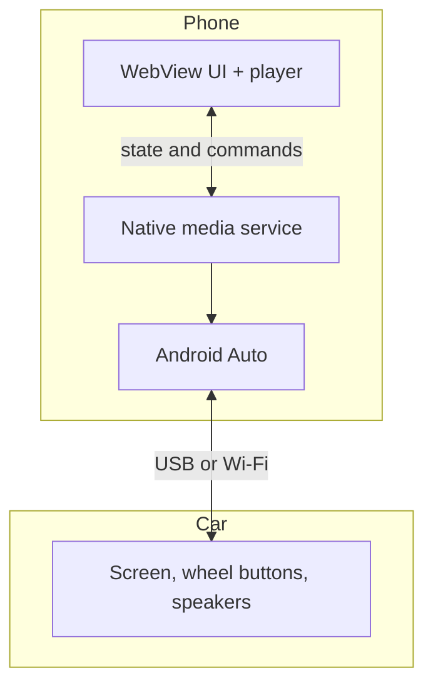
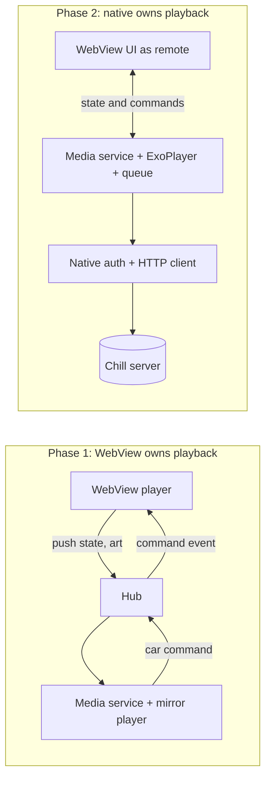
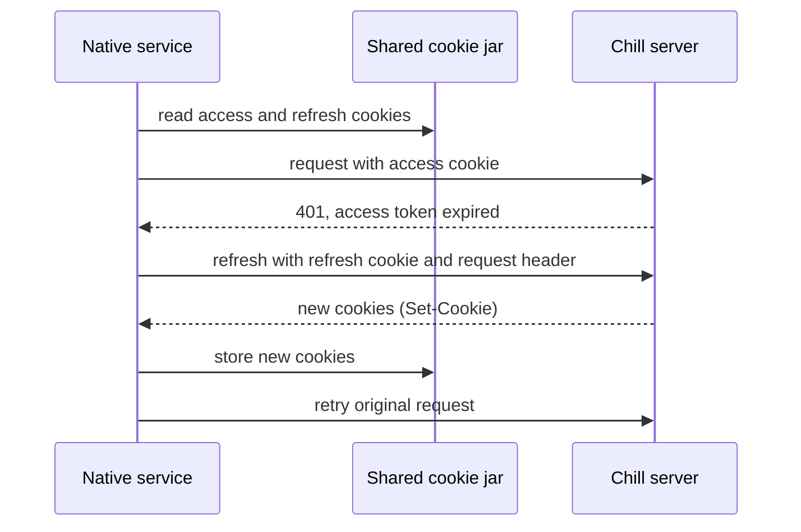

# Android Auto Support - Plan

## Goal Capsule

- **Objective:** Make Chill usable from Android Auto on the Pixel running the native app. Phase 1 is a car-side control for what the phone is playing. Phase 2 is browsing and playing from the car, with a native player that owns playback.
- **Product authority:** The Product Contract below. Where the Planning Contract and the Product Contract disagree on behavior, the Product Contract wins.
- **Execution profile:** Phase 1 (U1 to U6) is planned in full and ships as a usable milestone. Phase 2 (U7 to U11) is an outline. Re-plan it with `ce-plan` after phase 1 is verified in the car, because it rests on decisions phase 1 proves.
- **Stop conditions:** Stop and re-plan if, with the app in the background and the screen off, the WebView stops playing audio, stops advancing tracks, or stops receiving native commands (see U1), or if the native service cannot read the WebView's cookies (see U7).
- **Open blockers:** None.

---

## Product Contract

### Summary

Chill appears in Android Auto in two phases. Phase 1 shows now-playing and play, pause and skip controls for whatever the phone is playing, with the phone's WebView player unchanged. Phase 2 adds browsing and starting playback from the car screen, with a native player owning playback on the phone and the phone UI acting as a remote for it, so phone and car always show the same queue and position.

### Problem Frame

Bluetooth audio caps quality in the car (ADR-0002), and a web UI cannot project into Android Auto (ADR-0005), so the car is the one place the existing app cannot reach. Playback today lives entirely in the phone WebView (`client/state/playerStore.ts`), and the Android side is an empty shell (`android/app/src/main/java/com/adalfonso/chill/MainActivity.java`) with no media service.

### Key Decisions

- **Two phases: control first, browse second.** (session-settled: user-directed — chosen over a single browse-and-play release and over control-only: the control layer is useful on its own and de-risks the larger native player work.)
- **Native player owns playback on the phone in the end state; phase 1 mirrors the WebView.** (session-settled: user-approved — chosen over a car-only second player and over a permanent mirror: one source of truth, and a mirror cannot play from a cold car.) Governs R4, R9, R10.
- **Phone and car show the same playback, in sync.** (session-settled: user-directed — chosen over "phone UI takes over" and over treating the car as a DeviceConnect device.) Governs R4, R9.
- **Cold start in phase 1 shows a message instead of starting playback.** (session-settled: user-approved — chosen over resuming the last queue: starting the WebView from the car is costly before a native player exists.) Governs R5.
- **Phase 1 car view mirrors only the phone's own player, not a device the phone is remote-controlling.** (session-settled: user-approved — chosen over mirroring the remote device's state.) Governs R6.
- **Phone-to-phone control survives phase 2; Chromecast stays in the WebView and pauses native playback while casting.** (session-settled: user-approved — chosen over rebuilding both natively at once.) Governs R12, R13.
- **Start sideloaded, design to be Play-compliant.** (session-settled: user-directed — chosen over Play-only and over sideload-only.) Governs R1.

### Actors

- A1. Driver: the user, controlling Chill from the car screen or steering wheel.
- A2. Chill phone app: the existing WebView UI and player on the phone.
- A3. Chill native media service: the new Android-side component Android Auto talks to.
- A4. Android Auto: built into Android on the phone; draws the car UI and relays input.
- A5. Other Chill devices (for example the iPad): web clients linked through DeviceConnect.

In phase 1 the WebView is the source of truth and the native service mirrors it. In phase 2 the native player is the source of truth and the WebView is a remote.

### Requirements

**Phase 1: car control of the existing player**

- R1. Chill appears as a media app in Android Auto on a sideloaded install.
- R2. The car shows now-playing: title, artist, album art, play state, and position.
- R3. Play, pause, next, previous, and seek from the car screen or steering wheel act on the phone's current playback.
- R4. The car view always matches the phone's player; the car holds no state of its own.
- R5. When nothing is playing or the app is not running, Chill in the car shows a message to start playback on the phone.
- R6. While the phone is remote-controlling another Chill device, the car shows the same message as R5.
- R7. Phase 1 does not change existing playback, DeviceConnect, or login behavior.

**Phase 2: browse and play from the car**

- R8. The car can browse the library and start playback of a track or album chosen there.
- R9. A native player owns playback on the phone; the phone UI shows and controls the same queue and position as the car.
- R10. Tapping Chill in the car with nothing playing resumes the last queue without the phone UI open.
- R11. The scrubber and elapsed clock, volume, playback-error recovery, and audio-quality selection behave as they do today.
- R12. Phone-to-phone control works with the phone as source and as target.
- R13. Chromecast keeps working from the phone UI; native playback pauses while a cast session is active.
- R14. Gapless playback between tracks is at least as good as today.

**Sign-in**

- R15. The car needs no separate login. A signed-out phone shows a "sign in on phone" message in the car, and signing out on the phone ends car access.

### Key Flows

- F1. Phase 1 playback
  - **Trigger:** The phone connects to the car while music plays.
  - **Actors:** A1, A2, A3, A4
  - **Steps:** Chill shows now-playing in the car; the driver pauses or skips from the car; the phone player does so and both views update.
  - **Covered by:** R2, R3, R4
- F2. Phase 2 cold start
  - **Trigger:** The phone connects to the car with Chill closed.
  - **Actors:** A1, A3, A4
  - **Steps:** The driver taps Chill; the last queue resumes, or the driver browses and picks something; the phone UI, opened later, shows the same queue and position.
  - **Covered by:** R8, R9, R10

### Acceptance Examples

- AE1. **Covers R5, R6.** Given the phone is controlling the iPad and nothing plays locally, when the driver opens Chill in the car, then the car shows the "start playback on the phone" message.
- AE2. **Covers R3, R4.** Given a track plays on the phone, when the driver pauses from the car, then the phone UI shows paused without any further action.
- AE3. **Covers R9, R10.** Given a track plays from the car after a cold start, when the driver opens the Chill UI on the phone, then it shows the same track at the same position.
- AE4. **Covers R13.** Given a Chromecast session is active, when the driver connects to the car, then native playback does not start over the cast.

### Scope Boundaries

**Deferred for later**

- Offline downloads (builds on the native player; see ADR-0005).
- Play Store release.
- Voice search and Assistant commands.
- Showing or controlling another device's playback from the car.
- Any web-player behavior not listed in R11 to R14.

### Dependencies and Assumptions

- Android Auto is built into Android 10 and newer. A sideloaded app appears only when "Unknown sources" is enabled in Android Auto's developer settings (applies to R1).
- Assumption, unverified: a native service in the app can reuse the signed-in session the WebView already holds. R15 depends on this; U7 verifies it before phase 2 builds on it.
- The user's car supports Android Auto; whether it is wired or wireless is not yet known and affects testing.
- Builds on persistent login sessions (ADR-0009) and the native login handoff already merged.

### Outstanding Questions

**Deferred to Implementation**

- Whether the car is wired or wireless Android Auto, for the test plan.

### Sources

- `client/state/playerStore.ts`: web player, queue, and the preload element used for gapless swaps.
- `client/components/App/PlayControls/Scrubber.tsx`: position tracking and the gapless trigger.
- `client/lib/registerClientSocket.ts`: DeviceConnect client wiring.
- `android/app/src/main/java/com/adalfonso/chill/MainActivity.java` and `AndroidManifest.xml`: current native shell.
- `docs/adr/0002-audio-codec-and-quality-tiers.md`, `docs/adr/0005-offline-sync-deferred-to-native-client.md`, `docs/adr/0009-persistent-login-sessions.md`.

---

## Planning Contract

Product Contract preservation: unchanged, except Outstanding Questions, where the questions planning resolved moved into the Key Technical Decisions below.

### Key Technical Decisions

- KTD1. **Add an in-app Capacitor plugin for WebView-to-native messaging, backed by a process-wide hub.** The Android service can start with no Activity, and a Capacitor plugin only exists while the bridge is alive. The hub holds the latest pushed state and the command listener, and the plugin attaches to it when it loads. Governs R2, R3, R4.
- KTD2. **One media library service for both phases; only its player changes.** Android Auto discovers a media3 `MediaLibraryService` through the manifest. Phase 1 backs the session with a mirror player that reports the pushed state. Phase 2 swaps in ExoPlayer behind the same session, so the manifest and car-facing surface stay stable. Governs R1, R8, R9.
- KTD3. **In phase 1 the WebView is the only source of truth, and the mirror never changes state on its own.** Car commands go to the WebView, and the car view updates only from the next WebView push. (session-settled: user-approved — chosen over a permanent mirror: it cannot play from a cold car.) Governs R3, R4.
- KTD4. **Push on change and on a coarse timer, extrapolate position in between.** The WebView pushes on track change, play or pause, seek, buffering start and end, and remote-control change. It also pushes a position about every 15 seconds while playing, to bound drift when a stream stalls. It does not push every second. The native player computes position from the last push time while playing, and freezes it while buffering. Position and buffering come from the audio element's events, because the player store has no position signal. Governs R2.
- KTD5. **In phase 1 the WebView delivers album art as small thumbnails.** The cover endpoint requires the login cookie, and Android Auto fetches art URLs without it. The WebView already holds the cookie, so it fetches a 256px image and sends it in the push, cached per cover. This keeps phase 1 free of any native sign-in code. Governs R2.
- KTD6. **In phase 2 the native service refreshes its own login and writes the renewed cookies back to the shared cookie jar.** It reads the access cookie for the server URL and the refresh cookie for the refresh endpoint URL, because the refresh cookie is scoped to that path. It refreshes with the refresh cookie and the required request header. It stores each full `Set-Cookie` it gets back, with every attribute and the original path, so the WebView stays signed in. One native refresh runs at a time, and it reads the jar at refresh time and never caches a token. A concurrent WebView refresh is tolerated: the server returns the successor token when the presented token is the immediate predecessor and the replay is within 30 seconds, and it revokes the whole family for any older ancestor (ADR-0009 KTD3, `server/lib/auth/LoginSession.ts`). Asking the WebView to refresh is rejected because it cannot work on a cold start. Governs R10, R15.
- KTD7. **In phase 2 ExoPlayer streams the existing load endpoint with the cookie attached and the default container.** Android decodes Opus in Ogg natively, so the web player's CAF fallback for Safari does not apply. Range streaming (ADR-0004) already supports seeking. Governs R9, R11, R14.
- KTD8. **In phase 2 the native player owns the queue and stores the last queue on the phone.** The last queue is not stored anywhere today; player state only moves between live devices. Saving it on the phone is enough for R10 and avoids a server change. A server-side copy shared across devices is deferred. (session-settled: user-approved — chosen over a permanent mirror and over a car-only player: one source of truth.) Governs R9, R10.
- KTD9. **In phase 2 the browse tree starts small and uses the existing library endpoints.** The tree is shuffle all, playlists, albums, and artists, with no search. The native client calls the same tRPC routes the web UI uses. Governs R8.
- KTD10. **Inside the native shell, the player store delegates to the native player behind one seam; the web build and iPad keep the Audio-element player.** DeviceConnect target commands, the scrubber, volume, and error handling go through that seam. Chromecast stays in the WebView, and native playback pauses while a cast session is active. Governs R11, R12, R13.
- KTD11. **Native code stays Java and adds only media3 libraries.** The existing shell is Java, and media3 works from Java. This avoids adding a Kotlin build setup for one feature. Pin the media3 version at implementation to the current stable release and check it against Google's current Android Auto media guide, which I only read in part while planning.
- KTD12. **A single native-platform check gates every new client path.** On the web, the iPad, and the PWA the new modules do nothing. Governs R7.

### High-Level Technical Design

Phase 1 and phase 2 differ only in who owns the player. The service and the car-facing surface stay the same.

The phase 2 sign-in refresh keeps the WebView and the native service on one cookie jar:

### Assumptions

- The cookie manager returns HttpOnly cookies, including the `__Secure-` prefixed ones, for the server URL and for the refresh endpoint URL. U7 verifies this first.
- The WebView keeps playing audio while the app is in the background with the screen off. U1 verifies this before anything else.
- The media session shown in the car is built from the pushed state only. Android Auto draws the layout; this plan does not control it.

### Risks and Dependencies

- **The WebView may pause in the background.** Audio can keep playing while JavaScript and bridge events are throttled. Then track advance and every car command fail. Mitigation: U1 checks audio, auto-advance, and a command round-trip first, and the fallback is a foreground service that keeps the WebView alive.
- **Refresh races log the user out.** Two refreshes with the same token can trigger reuse detection and revoke the login session. Mitigation: KTD6's single native refresh, the server grace window, and a test for concurrent refreshes in U7.
- **Position drift.** Extrapolated position can differ from the WebView's, and a stalled stream freezes audio while the clock runs. Mitigation: push on seek, play-state change, and buffering changes, plus the coarse timer (KTD4).
- **Duplicate media controls.** The media3 service can add its own media notification beside whatever the WebView already shows. Mitigation: U6 checks the lock screen and notification shade, and U1 keeps the mirror player from taking audio focus.
- **Other apps connecting to the media service.** Android Auto needs the service exported. Mitigation: U1 accepts only Android Auto, the system media controller, and Chill's own package, and U9 carries the same rule into browsing.
- **Android Auto changes.** Sideload visibility and media3 behavior change across Android and Android Auto releases. Mitigation: verify against Google's current guide and on the Desktop Head Unit before the car.
- **Dependency:** the sign-in and native handoff work already merged (ADR-0009).

### System-Wide Impact

- The player store is the shared seam. The web build, the iPad, and the PWA must behave exactly as today; the new modules sit behind the native-platform check (KTD12).
- DeviceConnect keeps its server protocol. Only the phone-as-target path changes in phase 2, when commands go to the native player.
- No server changes in phase 1. Phase 2 needs none planned; re-check when re-planning.

---

## Implementation Units

### Phase 1: car control of the existing player

### U1. Android Auto wiring and media service skeleton

- **Goal:** Chill appears in Android Auto, and the service starts without the WebView and shows the "start playback on the phone" message.
- **Requirements:** R1, R5, R7
- **Dependencies:** none
- **Files:**
  - Create: `android/app/src/main/res/xml/automotive_app_desc.xml`
  - Create: `android/app/src/main/java/com/adalfonso/chill/media/ChillMediaService.java`
  - Create: `android/app/src/main/java/com/adalfonso/chill/media/MirrorPlayer.java`
  - Modify: `android/app/src/main/AndroidManifest.xml`
  - Modify: `android/app/build.gradle`, `android/variables.gradle`
  - Test: `android/app/src/test/java/com/adalfonso/chill/media/MirrorPlayerTest.java`
- **Approach:**
  - Declare Android Auto media support in the manifest, pointing to the new automotive app description.
  - Declare the service with the media3 library-service intent filter, per KTD2.
  - Declare the foreground-service and media-playback permissions and the media-playback service type, and decide whether the mirror posts a notification. The app targets Android 16, where a missing declaration crashes the service or hides its notification.
  - Accept a connecting controller only when it is Android Auto, the system media controller, or Chill's own package.
  - Add the media3 session dependency and pin its version in `variables.gradle`, per KTD11.
  - Build the session on `MirrorPlayer`, which extends media3's base player and holds one immutable state snapshot.
  - `MirrorPlayer` plays no audio and never requests audio focus, so it cannot interrupt the WebView's playback.
  - With no state pushed, report the message item from R5.
- **Execution note:** Before writing code, check on the Pixel, with the app backgrounded and the screen off, that the WebView keeps playing, that the next track starts on its own, and that an event sent from native reaches a WebView handler. If any of the three fails, take the foreground-service fallback or re-plan phase 1 (see Risks).
- **Patterns to follow:** The existing manifest structure and the `variables.gradle` version entries.
- **Test scenarios:**
  - With no pushed state, `MirrorPlayer` reports no media and the message item.
  - Happy path: after one pushed state, it reports that track, title, and play state.
  - Edge case: two states pushed in quick succession leave only the later one.
  - Edge case: a state with play state paused reports paused and a non-advancing position.
  - Edge case: a state with a duration reports it on the timeline, and a state with no next track reports next as unavailable.
  - Error path: a controller connecting from a package outside the allowlist is rejected.
- **Verification:** `./gradlew testDebugUnitTest` passes in `android/`. The debug APK installs. With Unknown sources on and the Desktop Head Unit connected, Chill appears and shows the message.

### U2. WebView-to-native messaging channel

- **Goal:** The WebView and the native service can exchange state and commands.
- **Requirements:** R2, R3, R4, R7
- **Dependencies:** U1
- **Files:**
  - Create: `android/app/src/main/java/com/adalfonso/chill/media/MediaBridgeHub.java`
  - Create: `android/app/src/main/java/com/adalfonso/chill/media/MediaBridgePlugin.java`
  - Modify: `android/app/src/main/java/com/adalfonso/chill/MainActivity.java`
  - Create: `client/lib/native/mediaBridge.ts`
  - Create: `common/nativeMedia.ts`
  - Test: `tests/mediaBridge.test.ts`
- **Approach:**
  - `common/nativeMedia.ts` holds the push and command payload types. It has no Prisma imports, per the project rule for shared types.
  - The plugin has one publish method and one command event. It attaches to the hub on load, per KTD1.
  - `MainActivity` registers the plugin before the base `onCreate`, as Capacitor requires for custom plugins.
  - `mediaBridge.ts` wraps the plugin behind the native-platform check from KTD12 and does nothing elsewhere.
  - Clear the hub's state and command listener when the plugin or the activity is destroyed. Also accept an explicit clear message from the client.
- **Patterns to follow:** Capacitor's custom-plugin registration. Verify the exact call against the installed Capacitor version.
- **Test scenarios:**
  - Happy path: on the native platform, publishing calls the plugin once with the payload.
  - Edge case: on the web, publishing is a no-op and does not throw.
  - Happy path: a command event reaches every subscribed handler.
  - Edge case: after unsubscribing, a handler receives no further commands.
  - Edge case: after teardown, the hub holds no state and no listener, and a later command is dropped.
- **Verification:** `pnpm test` passes. A debug build shows the plugin loading in the Chrome WebView inspector.

### U3. Push player state and album art to native

- **Goal:** The service always has the phone player's current track, play state, position, and art.
- **Requirements:** R2, R4, R7
- **Dependencies:** U2
- **Files:**
  - Create: `client/lib/native/syncPlayerToNative.ts`
  - Modify: `client/App.tsx`
  - Modify: `android/app/src/main/java/com/adalfonso/chill/media/MirrorPlayer.java`
  - Test: `tests/syncPlayerToNative.test.ts`
- **Approach:**
  - One module publishes on changes to the player store signals (`now_playing`, `is_playing`) and on the audio element's `seeked`, `playing`, `pause`, and `waiting` events, per KTD4. It also pushes a position on a coarse timer while playing. Mount it once from `client/App.tsx`.
  - Fetch the 256px cover for the current track through the existing cover endpoint and send it as a thumbnail, cached per cover filename, per KTD5. A failed fetch sends no art.
  - Include duration, whether a next and a previous track exist, a buffering flag, and whether the phone is remote-controlling another device. Take the remote flag from the outgoing-connection signal in `client/lib/registerClientSocket.ts`, because a virtual remote play also sets the local player signals.
  - `MirrorPlayer` computes position between pushes from the last push time while playing.
- **Patterns to follow:** The effect-based wiring in `client/lib/registerClientSocket.ts`.
- **Test scenarios:**
  - Happy path: a track change publishes new metadata once.
  - Happy path: pause then play publishes two play-state changes.
  - Edge case: a `seeked` event publishes immediately with the new position.
  - Edge case: no publish happens on position ticks between coarse timer pushes.
  - Happy path: a `waiting` event publishes buffering, and the next `playing` event clears it.
  - Edge case: a virtual remote play on the source publishes remote as true.
  - Happy path: the payload carries duration and reports next and previous as unavailable at the ends of the queue.
  - Error path: a failing cover fetch publishes state with no art and does not throw.
  - Edge case: the same cover requested twice is fetched once.
  - Integration: on the web, mounting the sync does nothing.
- **Verification:** `pnpm test` passes. On the Desktop Head Unit, playing a track on the phone shows its title and art.

### U4. Relay car commands to the WebView player

- **Goal:** Play, pause, next, previous, and seek in the car act on the phone's player.
- **Requirements:** R3, R4
- **Dependencies:** U2, U3
- **Files:**
  - Create: `client/lib/native/handleNativeCommands.ts`
  - Modify: `android/app/src/main/java/com/adalfonso/chill/media/MirrorPlayer.java`
  - Modify: `client/App.tsx`
  - Test: `tests/handleNativeCommands.test.ts`
- **Approach:**
  - `MirrorPlayer` forwards each car command to the hub, which emits the command event. It does not change its own state, per KTD3.
  - The client handler maps each command to the existing player store functions. Seek converts seconds to the percent the store expects, using the track duration.
  - After the player acts, the normal push from U3 updates the car.
- **Patterns to follow:** The existing store functions for play, pause, next, previous, and seek.
- **Test scenarios:**
  - Covers AE2. Pause from the car calls the store pause once, and the following push reports paused.
  - Happy path: next and previous call the matching store functions.
  - Edge case: a seek of 30 seconds on a 120 second track calls seek with 25 percent.
  - Edge case: an unknown action is ignored.
  - Error path: a command with no current track does nothing and does not throw.
- **Verification:** `pnpm test` passes. On the Desktop Head Unit, pause and skip from the car screen change the phone's player and the car view.

### U5. Message states for cold start, remote control, and sign-out

- **Goal:** The car shows the right message when there is nothing local to control.
- **Requirements:** R5, R6, and the sign-out half of R15 (signing out ends car access)
- **Dependencies:** U1, U3
- **Files:**
  - Modify: `android/app/src/main/java/com/adalfonso/chill/media/ChillMediaService.java`
  - Modify: `android/app/src/main/java/com/adalfonso/chill/media/MirrorPlayer.java`
  - Modify: `client/lib/native/syncPlayerToNative.ts`
  - Test: `android/app/src/test/java/com/adalfonso/chill/media/MirrorPlayerTest.java`
  - Test: `tests/syncPlayerToNative.test.ts`
- **Approach:**
  - Show the message when no state has been pushed (app closed or WebView on the login page) or when the pushed state says the phone is remote-controlling another device.
  - The login page is static HTML and does not run the player, so phase 1 cannot tell "closed" from "signed out". Use one message that covers both: open Chill on the phone, and sign in if needed. The separate "sign in on phone" state arrives in phase 2 with native sign-in (U7).
  - Clear the pushed state when the user signs out and when the WebView navigates to the login page, so the car stops showing the last track. Check Capacitor's page-load hook for the second case at implementation.
  - After a clear or a teardown, show the message and stop advancing position.
- **Test scenarios:**
  - Covers AE1. With remote control on and no local playback, the player reports the message.
  - Happy path: with local playback, the message does not show.
  - Edge case: when remote control ends and local playback resumes, the message clears on the next push.
  - Edge case: with no pushed state at all, the message shows.
  - Happy path: a clear message drops the track, art, and position, and the message shows.
  - Edge case: after the bridge is torn down, the player reports the message and stops extrapolating position.
- **Verification:** `./gradlew testDebugUnitTest` and `pnpm test` pass. On the Desktop Head Unit, closing the app shows the message, and starting playback replaces it.

### U6. Phase 1 verification and notes

- **Goal:** Phase 1 is proven in the real car, and the steps to repeat it are written down.
- **Requirements:** R1 to R7
- **Dependencies:** U1 to U5
- **Files:**
  - Create: `docs/android-auto.md`
- **Approach:**
  - Document enabling Unknown sources in Android Auto's developer settings, running the Desktop Head Unit, and a manual checklist covering each phase 1 requirement.
  - Check the lock screen and notification shade for a duplicate media notification beside the WebView's controls.
  - Run the checklist on the Desktop Head Unit, then in the car, wired or wireless.
- **Test expectation:** none. This unit is a manual verification and a document.
- **Verification:** The checklist passes in the car. Before phase 2 is planned in detail, the notes say whether background audio, art, and seek behaved as assumed.

### Phase 2: browse and play from the car (outline; re-plan before starting)

### U7. Native authenticated client

- **Goal:** The native service can call the server as the signed-in user and stay signed in.
- **Requirements:** R10, R15
- **Dependencies:** U6
- **Files:** `android/app/src/main/java/com/adalfonso/chill/media/auth/` (new), unit tests under `android/app/src/test/`
- **Approach:**
  - Verify first that the cookie manager returns the HttpOnly `__Secure-` access cookie for the server URL and the refresh cookie for the refresh endpoint URL. If it does not, stop and re-plan.
  - Implement the read, refresh, write-back, and single-flight behavior from KTD6.
  - Add the separate "sign in on phone" message state.
  - On sign-out or a failed refresh, delete the saved queue (U8) and block resume.
- **Test scenarios:**
  - Happy path: a 401 triggers one refresh, stores the new cookies, and retries.
  - Error path: a refresh that returns 401 reports signed out and does not loop.
  - Integration: two simultaneous refresh needs produce one refresh request.
  - Edge case: after a refresh, the WebView's next request uses the renewed cookies.
  - Integration: after a write-back, HttpOnly, Secure, and the original path survive on the stored cookie.

### U8. Native player, queue, and last-queue resume

- **Goal:** A native ExoPlayer plays from the server and owns the queue.
- **Requirements:** R9, R10, R14
- **Dependencies:** U7
- **Files:** `android/app/src/main/java/com/adalfonso/chill/media/ChillMediaService.java`, a new queue store file, `android/app/build.gradle`
- **Approach:**
  - Swap ExoPlayer in behind the existing session, per KTD2. Stream the load endpoint with the cookie attached, per KTD7.
  - Persist the queue and position on change, and resume them on a cold tap, per KTD8.
  - Exclude the saved queue from device backups, and never store tokens outside the cookie jar.
- **Test scenarios:**
  - Covers AE3. After a cold-start resume, the queue and position match what was saved.
  - Edge case: a corrupt saved queue is discarded and the message shows.
  - Edge case: gapless advance between two tracks has no audible gap on the device.

### U9. Browse tree

- **Goal:** The car can browse and start playback.
- **Requirements:** R8
- **Dependencies:** U7, U8
- **Files:** `android/app/src/main/java/com/adalfonso/chill/media/ChillMediaService.java`, a new library client file
- **Approach:** Build the tree from KTD9 using the existing library routes, with album art through the authenticated client. Apply the same caller allowlist as U1 to every browse and playback request.
- **Test scenarios:**
  - Happy path: the root lists shuffle all, playlists, albums, and artists.
  - Happy path: choosing an album queues its tracks and starts playback.
  - Error path: a failed library call shows an error item and does not crash the service.

### U10. Flip the bridge: WebView as remote

- **Goal:** The phone UI controls the native queue, and phone-to-phone control keeps working.
- **Requirements:** R9, R11, R12, R13
- **Dependencies:** U8
- **Files:** `client/state/playerStore.ts`, `client/components/App/PlayControls/Scrubber.tsx`, `client/lib/registerClientSocket.ts`, `client/lib/native/` modules
- **Approach:**
  - Add the native delegation seam from KTD10 behind the native-platform check, and leave the web path unchanged.
  - Route scrubber position, volume, error recovery, and DeviceConnect target commands through it. Pause native playback while casting.
- **Test scenarios:**
  - Covers AE4. With a cast session active, native playback does not start.
  - Happy path: a DeviceConnect play command from the iPad starts native playback on the phone.
  - Integration: on the web build, the store behaves as before.
  - Happy path: the scrubber shows native position and seeks the native player.

### U11. Phase 2 verification and cleanup

- **Goal:** Phase 2 is proven in the car, and leftover scaffolding is gone.
- **Requirements:** R8 to R15
- **Dependencies:** U9, U10
- **Files:** `docs/android-auto.md`
- **Approach:** Extend the manual checklist for browsing, cold start, DeviceConnect, and Chromecast. Remove any mirror-only code that phase 2 made unused.
- **Test expectation:** none. This unit is manual verification and cleanup.

---

## Verification Contract

| Gate | Command | Applies to |
| --- | --- | --- |
| Type-check, lint, tests | `pnpm check` | every unit with client code |
| Client tests | `pnpm test` | U2 to U5, U10 |
| Android unit tests | `./gradlew testDebugUnitTest` (run in `android/`) | U1, U5, U7 to U9 |
| Native build | `pnpm cap:build`, then `pnpm cap:run` with the device ID | every unit |
| Android Auto behavior | Desktop Head Unit, then the car | U1, U3 to U6, U11 |

Behavior in Android Auto is checked by hand. There are no automated car-UI tests, per the confirmed scope.

## Definition of Done

**Global**

- Every requirement R1 to R7 is met and checked in the car for phase 1. R8 to R15 are met after phase 2.
- `pnpm check` and `./gradlew testDebugUnitTest` pass.
- The web build and iPad behave as before (R7, R12).
- Dead-end and experimental code from abandoned attempts is removed from the diff.

**Per unit**

- U1: Chill appears in Android Auto and shows the message.
- U2: the plugin loads and the wrapper is a no-op on the web.
- U3: title, art, and play state reach the car.
- U4: pause and skip from the car change the phone's player.
- U5: each message state shows in the right situation.
- U6: the checklist passes in the car and the notes are written.
- U7 to U11: outlined; define their done criteria when re-planned.

## Open Questions

**Deferred to Implementation**

- Which media3 version to pin, and whether Google's current Android Auto guide changes any manifest detail (KTD11).
- How the native client should call the existing tRPC routes over plain HTTP in phase 2 (KTD9).
- Whether position push cadence needs tuning after the car test (KTD4).
